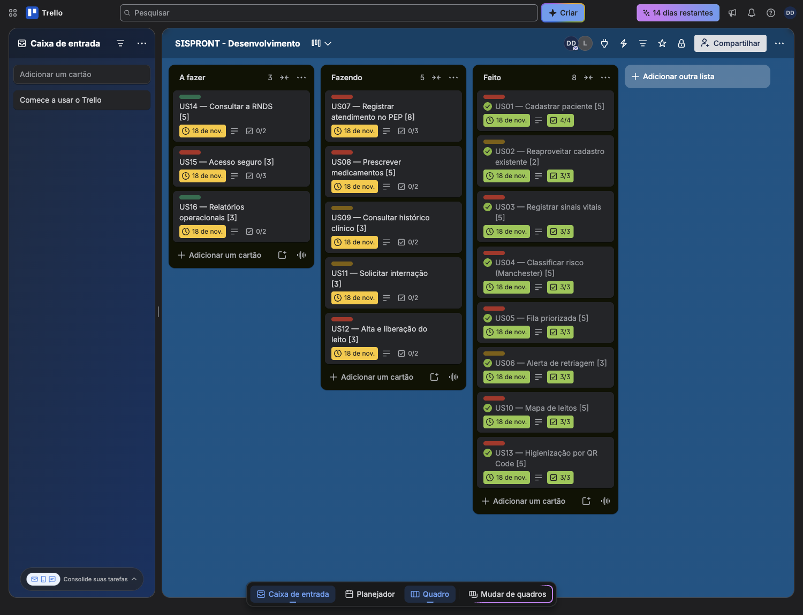

# SISPRONT

Sistema de Gestão Hospitalar com triagem pelo Protocolo de Manchester e prontuário eletrônico (PEP).

Projeto acadêmico — UCSAL, Análise e Desenvolvimento de Sistemas.

## Escopo
- Cadastro de pacientes e triagem com classificação de risco (Manchester)
- Fila de atendimento priorizada
- Prontuário eletrônico e histórico clínico
- Mapa de leitos e higienização por QR Code

## Stack prevista
Spring Boot (back-end), HTML/CSS/JS (front-end) e banco de dados relacional.

## Acompanhamento (Trello)
Quadro com as user stories organizadas em A fazer, Fazendo e Feito:

## Documentação
O código-fonte será adicionado pelo time.
